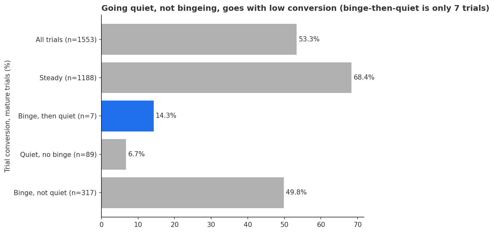

# Beam Analyst (course build)

This is my build of the course project: an AI analyst scoped to Beam's data, with the Frame, Validate and Deliver skills written and tested on the Beam price-increase question. It is a learning build, not the reusable analyst I plan to make for other datasets.

The analyst is an AI data analyst that runs inside Claude Code and answers business questions about Beam's data. Beam is a media app where users browse, listen to and read content on free, monthly and annual plans. You ask a question in plain words; the analyst frames it, profiles the data, analyses it with pandas, checks its own work and hands back a written brief.
## My build notes

My own record of how this version was set up, written as I built and tested the skills. The course text above is unchanged.

### Decisions we made

- **Frame asks, never guesses.** No decision named means it stops and asks. It also asks for what result would change the decision, agreed before any data is looked at, and asks (with options) about any word that has more than one meaning.
- **Deliver reads `review.md` first.** Fix first means no brief. Think on it means a brief where every review finding goes into Checks, fixed or not.
- **Validate never edits `analysis.py`.** It reviews; the caller fixes. A repeat review starts fresh and then checks each earlier finding.
- **Chart helper:** `bar()` takes `value_fmt` so percentages keep decimals, and `line()` tilts month labels. Kept small on purpose.
- **Run folders are not tracked by git** (`outputs/`), so a run needs no branch; changes to skills, helpers and notes do.

### Questions I asked, and the answers (2026-11-12)

I am not part of the fictional company, so I could not confirm what the data means. I asked the course instructors. Confirmed answers now live in `knowledge/beam/quirks.md`.

> [!NOTE]
> **What does `canceled` mean to Beam?** In the data, every past-dated `canceled` end falls in Aug 2026, and Aug 2026 has no `expired` ends. The brief counts `canceled` plus `expired` as churn: +3.42 points, above the 3-point roll-back line. **Answer (Adel Hassen):** the label for ended subscriptions changed from `expired` to `canceled` for end dates from August 2026. Both mean the subscriber has left, so the brief stands as written. Added to `quirks.md`.

> [!NOTE]
> **Is the Jul 2026 start spike a quirk?** 491 monthly starts in Jul and 323 in Aug 2026, against about 200 in a normal month. Holding the tenure mix fixed still gives +3.91 points, so the spike does not explain the rise. **Answer (Andres Vourakis):** July is a data quirk, not a promotion, so those cohorts need no special treatment. August is real: it is the free trial launch. Added to `quirks.md`.

- **Who confirms a quirk?** `profile` asks before writing to `quirks.md`. With no user present it writes its guess in the table note instead. **Answer (Adel Hassen):** that is the right safe default. Quirks often come from outside the data (a policy change, a promo), so a person with business knowledge confirms them. The full loop: the analyst finds a quirk, writes it in the table note, a data scientist and a business expert confirm it, then it goes into `quirks.md`.
- **Is the annual plan a fair control group?** It supports the price as the cause but cannot prove it. **Answer (Adel Hassen):** an okay comparison, not apples to apples, since annual subscribers are likely more committed. Another monthly group would be a better control, because it shares the same billing schedule and renewal timing.

### What changed this week (2026-11-12 to 2026-11-16)

| Change | Why it matters |
| --- | --- |
| Instructor answers added to `quirks.md` (July spike, `canceled` label) | Two open questions are closed, so later runs do not re-ask them |
| Semantic layer: one `.yml` per table in `knowledge/beam/` | What a column means now comes from one place, not from column names or database comments |
| `course-db` launcher (MCP Toolbox, Postgres) | Lets the analyst reach `sessions` (4.3 million rows, no CSV), which the CSVs do not hold |
| `profile` and `analyse` skills updated | They check the database instead of guessing, and rerun notes say which numbers came from SQL |
| New table notes: `trials.md`, `sessions.md` | Both were needed for the next question and had no profile yet |

### Question in progress: binge then quiet trials

Question: do trial users who binge on day one and then go quiet convert worse than steady users? The head of growth decides whether onboarding emails should push users to spread their first week out.

Assumptions chosen before looking at any data (full list in the run's `frame.md`, which is not tracked):

1. Binge: top 20% of trial users by day-1 sessions.
2. Quiet: no sessions on trial days 2 to 4.
3. Steady: active on 4 or more of trial days 1 to 7.
4. Decision rule: push the emails if binge-then-quiet users convert at least 5 percentage points lower than steady users; otherwise leave them.
5. Mature trials only, so open trials are never counted as failures.
6. A gap shows association, not that spreading use out would raise conversion.

Result (mature trials only, brief not tracked): binge-then-quiet trials converted at 14.3% (1 of 7) against 68.4% for steady trials (812 of 1,188), a gap of 54.1 percentage points. Only 7 trials fall in that group, so the size is uncertain. Going quiet, not bingeing, is what goes with low conversion: quiet trials without a binge converted at 6.7% (6 of 89). Suggested direction: re-engage people on days 2 to 4 instead of discouraging a day-1 binge, and test it, since quiet may be a result of deciding to leave. Peer review verdict: Think on it (small group, quiet versus binge, chart labels), all three addressed.



What I learned: the first session query took minutes (no index on `sessions.user_id`), so the analyst now aggregates in SQL, saves the query in `queries.sql` and the small result as a CSV, and a check in code confirms the CSV adds back to the trials file.

### Lessons from testing

- **"Churn" is a vague word too.** The question never said whether a canceled subscriber counts, and the answer changed the size of the result. Pin down every key word, including the ones that feel obvious.
- **Describe timing only from a table that shows timing.** A two-bucket total ("0 before, 355 after") led to the wrong claim that canceled ends started after March. Show a change by month before explaining it.
- **A sensitivity test can be biased.** Counting `expired` only looked like a fair alternative but dropped all of August.
- **Re-testing finds what the first test missed.** The first chain run exposed a missing field between `frame` and `analyse`; the rerun exposed the churn definition.

---

## How It Works

1. **Frame** - Pins the question, the decision it informs and the audience
2. **Profile** - Describes each table from the data and writes it down
3. **Analyse** - Writes pandas code that can be rerun, where every number carries a comparison
4. **Validate** - Peer reviews its own work: mechanics first, then reasoning
5. **Deliver** - Writes a brief with the recommendation first and a Checks section

## Setup

### Prerequisites

- Python 3.10 or 3.11
- [Poetry](https://python-poetry.org/docs/#installation)
- [Claude Code](https://docs.claude.com/en/docs/claude-code/overview)

### Installation

1. **Install Poetry** (if not already installed):
   
   **Windows (PowerShell)**:
   ```powershell
   (Invoke-WebRequest -Uri https://install.python-poetry.org -UseBasicParsing).Content | py -
   ```
   
   **macOS/Linux**:
   ```bash
   curl -sSL https://install.python-poetry.org | python3 -
   ```
   
   After installation, restart your terminal. If `poetry` command is not found:
   - **Windows**: Add `%APPDATA%\Python\Scripts` to your system PATH
   - **macOS/Linux**: Add `export PATH="$HOME/.local/bin:$PATH"` to your `~/.bashrc` or `~/.zshrc`

2. **Install dependencies**:
   ```bash
   poetry install
   ```

3. **Start Claude Code**:
   ```bash
   claude
   ```
   Run `claude` from the repo root so it picks up the project's skills and instructions.

## How the agent is put together

There is no framework and no Python program controlling the model. The agent is a Claude Code project:

- **An entry-point skill:** `.claude/skills/analyst/SKILL.md` lists the five steps in order, and `/analyst <question>` runs them.
- **Routing lines:** a few lines in `AGENTS.md` say which skill handles which kind of request. A business question runs the full chain, a file to check goes to Validate, and finished results go to Deliver.
- **One skill per step:** each step is its own skill under `.claude/skills/`.
- **A knowledge folder:** `knowledge/beam/` holds one note per table (Profile writes these), a file of known quirks, and a corrections file the agent reads before every run and adds to when you correct it.
- **Helpers:** small Python modules in `helpers/`. Claude writes the analysis script, and the arithmetic runs in code, never in the model's head.
- **One output folder per question:** the brief, the charts and the script that produced the numbers, so anyone can rerun it.

## What you will build

The course shipped the Profile and Analyse skills and the helpers. I wrote the Frame, Validate and Deliver skills, each in its own folder under `.claude/skills/`, and tested the whole chain on the question "what did the March 2026 price increase cost in retention?". Table notes for four tables are in `knowledge/beam/`. The course's finished version lives in [the reference repo](https://github.com/Future-Proof-DS/ai-analyst), for comparison.

Before touching any data, the analyst reads `knowledge/beam/`, which holds the known quirks of Beam's tables and any corrections it has been given.

## Project Structure

```
beam-analyst-course/
├── data/                 # Beam's exported tables (CSV)
├── knowledge/beam/       # Known data quirks and corrections
├── helpers/              # Shared Python helpers for analysis scripts
├── outputs/              # One folder per question (not tracked)
├── .claude/              # Skills for Claude Code
└── pyproject.toml        # Dependencies
```

## Data

- `users.csv`: 31,165 rows, one per user
- `subscriptions.csv`: 30,747 rows, one per subscription
- `payments.csv`: 100,914 rows, payments from 2025-01-01
- `trials.csv`: 2,073 rows, one per trial
- `user_activity_metrics.csv`: 998 daily rows of active user counts (dau, wau, mau)

Session-level data is not in the CSVs. `sessions` (about 4.3 million rows) is only in the database, reached through `course-db`.


---

*Future Proof Data Science - Teaching data scientists to optimize workflows with AI*
