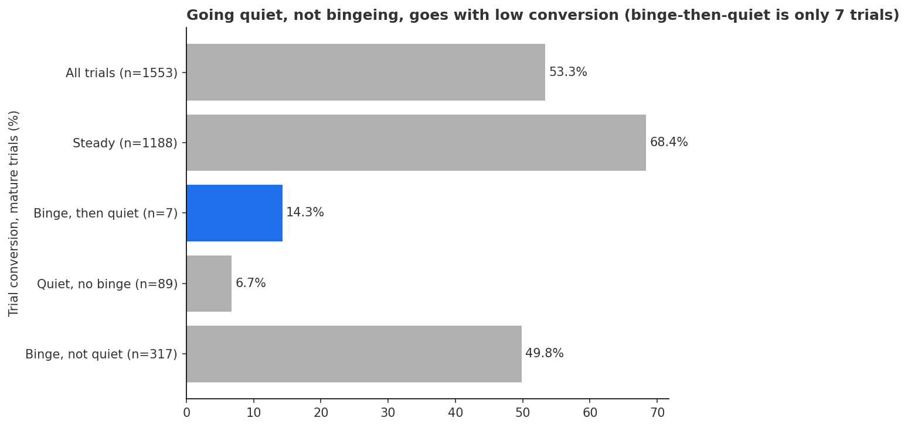

# Do trial users who binge on day one and then go quiet convert worse than steady users?

## Objective

Find out whether trial users who binge on trial day 1 and then go quiet convert to paid at a lower rate than steady users. The head of growth decides whether onboarding emails should push trial users to spread their first week out.

## Key takeaways

- Binge-then-quiet trials converted at 14.3% (1 of 7), against 68.4% for steady trials (812 of 1,188), a gap of 54.1 percentage points with a 95% interval of 16.9 to 66.1 points, well past the 5 point line agreed in advance.
- The group is only 7 of 1,553 mature trials (0.5%), so the size of the gap is uncertain and an email change aimed at day-1 bingers would reach almost nobody.
- Going quiet, not bingeing, is what travels with low conversion: quiet trials that did not binge converted at 6.7% (6 of 89), while bingers who did not go quiet converted at 49.8% (158 of 317), against 53.3% for all mature trials (828 of 1,553).

## Recommendations

- On the rule agreed before the data (push if the gap is 5 points or more), the answer is yes: binge-then-quiet converts worse. But 7 trials cannot carry a decision on their own, so do not build the email change on this group.
- Spend the effort on the quiet trials instead. A message that brings people back on days 2 to 4 targets 89 trials here that convert at 6.7%, not a handful of bingers.
- Less sure of: whether an email can change this. Users who are going to cancel may simply stop using Beam, so going quiet may be a result of deciding to leave, not a cause. This analysis cannot separate the two. A small test (re-engagement email to quiet users against none) would.

## Analysis

### Binge-then-quiet trials convert far below steady ones, but only 7 trials fall in that group

| Group | Mature trials | Converted | Conversion |
| --- | --- | --- | --- |
| All mature trials (baseline) | 1,553 | 828 | 53.3% |
| Steady (4+ active days in days 1 to 7) | 1,188 | 812 | 68.4% |
| Binge then quiet | 7 | 1 | 14.3% |
| Quiet days 2 to 4, did not binge | 89 | 6 | 6.7% |
| Binge, not quiet | 317 | 158 | 49.8% |
| Everyone else (not steady, not binge-then-quiet) | 358 | 15 | 4.2% |

Source: `data/conversion_by_group.csv`, built by `analysis.py` from `data/trial_groups_from_db.csv` (query in `queries.sql`). Filter: mature trials only (ends 2026-09-24 or earlier, outcome converted or canceled). Binge means 7 or more sessions on trial day 1, which is the top 20.9% (ties push it over 20%). Quiet means no sessions on days 2 to 4. Steady means active on 4 or more of days 1 to 7; the 3 trials that were both binge-then-quiet and steady are counted as binge-then-quiet only. Gaps are percentage points, not relative percent.

### Moving the binge cut from 3 to 8 sessions keeps the gap between 51.7 and 61.7 points

| Binge cut (day-1 sessions) | Binge-then-quiet trials | Their conversion | Steady conversion | Gap (points) |
| --- | --- | --- | --- | --- |
| 3 or more | 29 | 6.9% | 68.4% | 61.5 |
| 4 or more | 21 | 9.5% | 68.4% | 58.8 |
| 5 or more | 15 | 6.7% | 68.4% | 61.7 |
| 6 or more | 11 | 9.1% | 68.4% | 59.3 |
| 7 or more (used) | 7 | 14.3% | 68.4% | 54.1 |
| 8 or more | 6 | 16.7% | 68.4% | 51.7 |

Source: `data/sensitivity_binge_cut.csv`. The direction does not depend on where the binge line sits, but every version has fewer than 30 trials.

## Checks

**Verified (in code, `analysis.py`):**
- Group counts add back to 1,553 mature trials and 828 conversions in `trials.csv` (0.00% apart).
- Each user has one trial, so no join multiplies rows.
- Open trials are excluded. Every mature trial's first 7 days fall before the data end date of 2026-09-24.

**Not verified:**
- The group counts came from the database (`queries.sql`) and were copied into a CSV by hand. They add back to the trials file, but the query was not rerun for this brief. It takes minutes because `sessions` has no index on `user_id`.
- No split by device, country or sign-up week, so a different mix of users in each group is not ruled out.
- Cause and effect. See the last recommendation.

**Findings from the review (`review.md`, verdict Think on it):**
1. **Headline rests on 7 trials.** Fixed: the gap interval now uses the Newcombe method (safe at small counts), giving 16.9 to 66.1 points, and the group size and the single conversion sit next to the number. The result is still too small to size the effect; read the direction, not the 54.1.
2. **It is the quiet, not the binge.** Fixed in the takeaways and the chart title, using the rows already in `analysis.py`. Binge-then-quiet (14.3%, n=7) cannot be told apart from quiet-without-binge (6.7%, n=89) at this size. The steady baseline leaves out 3 trials that met both rules, and "Everyone else" is a much less active mix, so neither is a clean baseline.
3. **Chart labels overlapped.** Fixed: the chart is now horizontal with short labels and each group's size, and renders readably.
