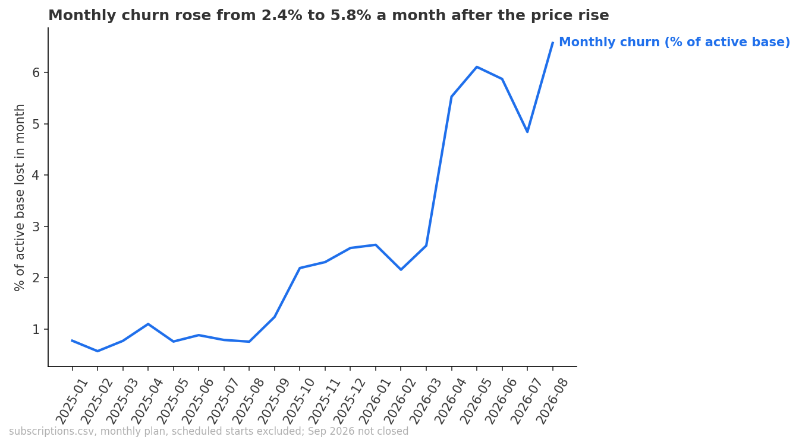
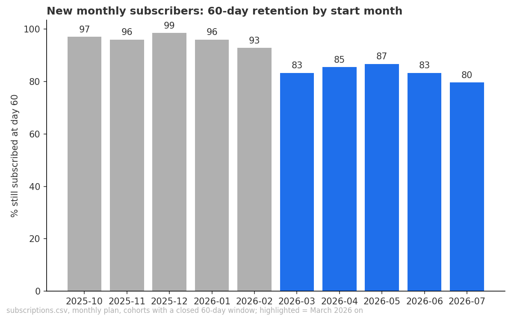

# Monthly price rise: retention cost

## Objective

What did the March 2026 monthly price rise from $10 to $12 cost Beam in retention? The head of growth will decide whether to keep $12, roll back to $10, or offer a discount to at-risk subscribers.

## Key takeaways

- Monthly-plan churn averaged 5.79% of the active base per month from April to August 2026, against 2.37% from October 2025 to February 2026, a rise of 3.42 percentage points (about 144% relative).
- Of new monthly subscribers who started in April to July 2026, 83.9% were still subscribed after 60 days, against 95.8% of those who started in October 2025 to February 2026, a drop of 11.9 percentage points.
- Monthly-plan revenue averaged $65,635 a month from April to August 2026, against $50,730 from October 2025 to February 2026 (+29.4% relative), so the higher price has so far more than covered the lost subscribers, but churn is still climbing.

## Recommendations

- Do not roll back on retention alone: revenue from monthly payments is up 29.4% relative, and the active monthly base is about level (5,364 on average after against 5,277 before).
- Test a discount or save offer for monthly subscribers, since churn is 2.4 times the earlier level and the 60-day retention of new subscribers has fallen sharply. Churn is higher in every country and device group (see table), so the offer need not be narrowly targeted; the largest rises are in India, EU and Web users.
- Less sure: whether the price caused the rise. The data has no control group and churn did not move in March itself (2.62%) but in April (5.53%). Treat the figures as an association until checked against another plan or a holdout.

## Analysis

### Monthly churn roughly doubled from April 2026 and was already above its early-2025 level

Source: `data/monthly_churn.csv`, from `subscriptions.csv`, monthly plan, scheduled starts after 2026-09-24 excluded, months January 2025 to August 2026. Against the January to August 2025 baseline of 0.80% a month, the after period is up 4.99 percentage points; against January to February 2026 (2.40%) it is up 3.39 percentage points.

### New monthly subscribers are leaving faster, with 60-day retention falling from the mid 90s to the low 80s

Source: `data/cohort_60d_retention.csv`, monthly plan, starts from 2025-01 whose 60-day window closed by 2026-09-24 (later starts excluded).

### The rise in churn appears in every country and device group, and is smallest for US and iOS users

Source: `data/churn_by_segment.csv`; same filters as above; percentage-point change, pooled before (Oct 2025 to Feb 2026) vs after (Apr to Aug 2026).

| Segment | Before % | After % | Change (pp) |
| --- | --- | --- | --- |
| US | 2.24 | 4.88 | +2.63 |
| EU | 2.20 | 6.17 | +3.97 |
| India | 2.42 | 6.62 | +4.19 |
| Rest | 2.75 | 6.47 | +3.72 |
| iOS | 2.00 | 4.39 | +2.39 |
| Android | 2.27 | 6.20 | +3.93 |
| Web | 2.88 | 6.96 | +4.08 |

## Checks

Verified in `analysis.py`: partial edge periods flagged (start dates run to 2026-10-04 and payments end 2026-09-24, so September 2026 is excluded); no join fanned out; segment churn counts sum to the totals; 1,113 of 5,600 cohort rows excluded because the 60-day window had not closed; 425 scheduled starts after the data end excluded; future end dates treated as still active.

Not verified (from `review.md` and the analysis):
- Whether the price caused the churn rise: no control group (for example annual plan), and the March-to-April timing is unexplained.
- The pre-change baseline is itself above early 2025 (0.80% a month); the September 2025 signup anomaly sits just before the baseline window, and its ageing may account for part of the October 2025 step.
- Canceled and expired subscriptions are pooled as churn.
- Revenue figures are descriptive payment totals, not net of other effects. The cause of the rise was not tested.
