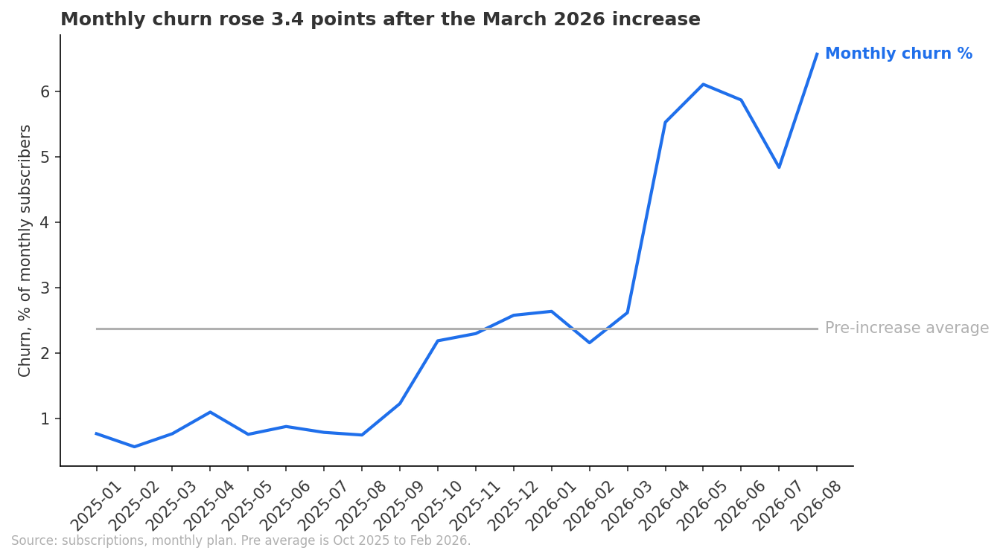
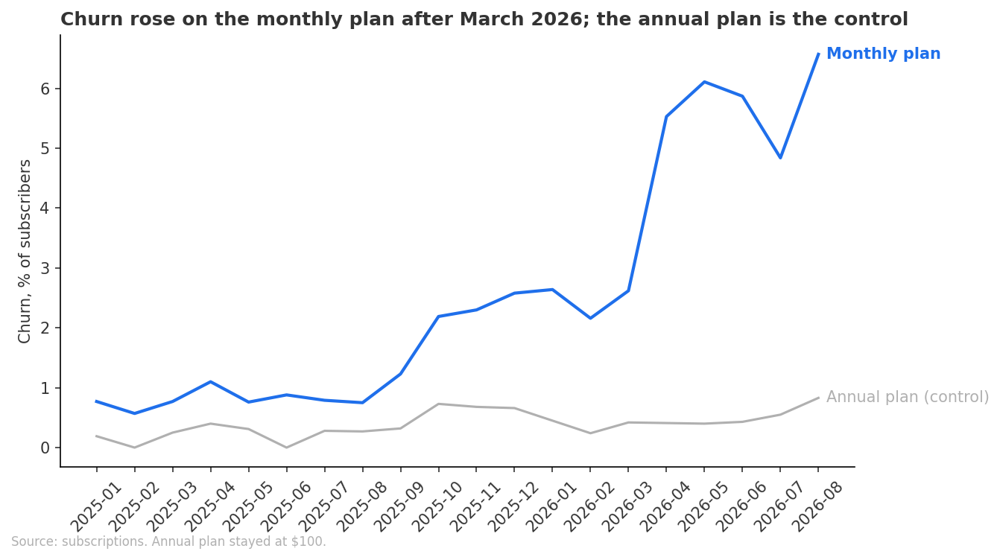
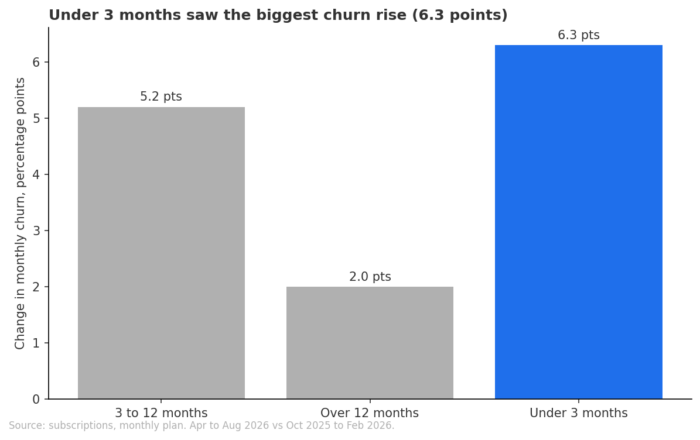
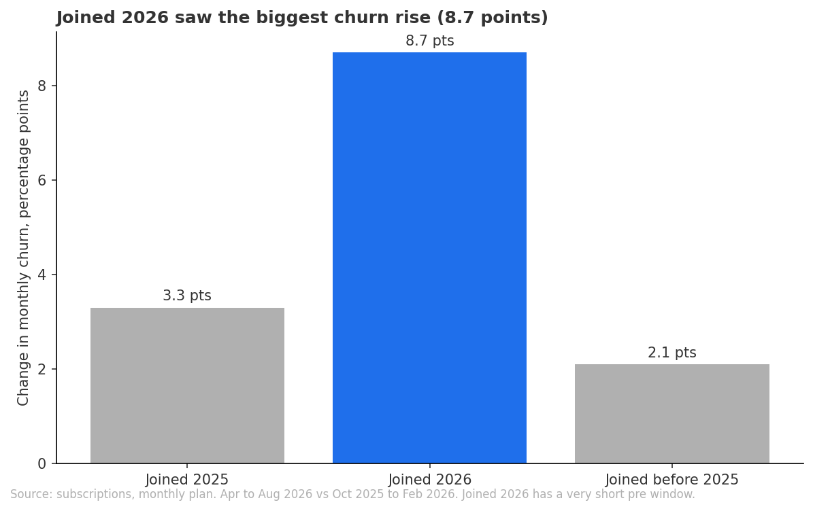

# Price increase and churn: brief

## Objective

Did Beam's monthly price rise from $10 to $12 in March 2026 cost it retention, measured as extra monthly-plan subscribers lost? The head of growth uses the answer to recommend keeping $12 or rolling back to $10, and stakeholders make the final call.

## Key takeaways

1. Monthly-plan churn (canceled plus expired) averaged 5.79% a month from April to August 2026, against 2.37% a month from October 2025 to February 2026, a rise of 3.42 percentage points, above the 3-point roll-back line agreed in the frame.
2. Holding the tenure mix fixed at its pre-increase shape, churn rose from 2.37% to 6.28%, a rise of 3.91 percentage points, so the result does not come from having more new subscribers in the after period.
3. The rise is uneven: subscribers with over 12 months of tenure went from 1.21% to 3.19% (+1.99 points), while those under 3 months went from 3.33% to 9.63% (+6.30 points) and those at 3 to 12 months from 3.47% to 8.68% (+5.21 points).

## Recommendations

- Roll back the monthly price from $12 to $10. The rule agreed in `frame.md` before any data was examined says that a rise of more than 3 points triggers a roll-back, and the measured rise is +3.42 points (+3.91 when the tenure mix is held fixed). The stakeholders make the final call.
- Present the result to stakeholders together with the limits in Checks: the rule result depends on counting canceled subscriptions as churn, the annual-plan comparison is supporting evidence only, and nothing here proves the price caused the rise.
- Be less sure about the size of the effect than about its direction. Churn had already stepped up in Oct 2025, before any price change, and the baseline range is in Checks.
- Subscribers with over 12 months of tenure rose by less than the line (+1.99 points). If stakeholders weigh the established base most, they should know that group alone does not trigger the rule.

## Analysis

### Monthly churn roughly doubled after March 2026 and stayed high through August

Churn sat at 0.6% to 1.2% a month through Sep 2025, stepped up to about 2.2% in Oct 2025 and 2.2% to 2.6% through March 2026, then rose to 5.5% in April and 4.8% to 6.6% from May to August 2026. March 2026 is the transition month and is left out of both averages.

Source table: `data/monthly_churn.csv` (monthly plan, one row per month).

### Monthly churn jumped after March 2026 while annual churn stayed at 0.4% to 0.8%

The annual plan stayed at $100, so it was not exposed to the price rise. Its churn was 54 of 9,887 subscriber-months before (0.55%) and 62 of 11,657 after (0.53%). Month by month from April to August 2026 it was 0.41%, 0.40%, 0.43%, 0.55% and 0.83%, so it rose in July and August. The monthly plan in the same months ran at 5.5% to 6.6%, except 4.8% in July.

Source tables: `data/monthly_churn.csv` and `data/annual_control_churn.csv` (pre Oct 2025 to Feb 2026, post Apr to Aug 2026).

### Subscribers under 3 months of tenure saw the biggest rise, and those over 12 months the smallest

| Tenure at month start | Before | After | Change (points) |
|---|---|---|---|
| Under 3 months | 3.33% | 9.63% | +6.30 |
| 3 to 12 months | 3.47% | 8.68% | +5.21 |
| Over 12 months | 1.21% | 3.19% | +1.99 |

Source table: `data/churn_by_segment_pre_post.csv` (Tenure rows), with monthly detail in `data/churn_by_tenure.csv`.

### Subscribers who joined in 2026 saw the biggest rise, but their before period is very short

Joined 2026 went from 0.91% to 9.59% (+8.68 points), Joined 2025 from 3.46% to 6.71% (+3.25 points), and Joined before 2025 from 1.31% to 3.44% (+2.13 points).

Source table: `data/churn_by_segment_pre_post.csv` (Join period rows), with monthly detail in `data/churn_by_join_period.csv`.

### The monthly count of subscriptions ending doubled in April 2026, and the status label changed in August

| Month | Canceled | Expired | Total ends |
|---|---|---|---|
| Feb 2026 | 0 | 116 | 116 |
| Mar 2026 | 0 | 146 | 146 |
| Apr 2026 | 0 | 313 | 313 |
| May 2026 | 0 | 337 | 337 |
| Jun 2026 | 0 | 312 | 312 |
| Jul 2026 | 0 | 254 | 254 |
| Aug 2026 | 355 | 0 | 355 |

Across the five months before (Oct 2025 to Feb 2026) there were 0 canceled and 630 expired ends. Across the five months after (Apr to Aug 2026) there were 355 canceled and 1,216 expired. All 355 canceled ends sit in Aug 2026 and no expired ends appear that month. Source table: `data/monthly_ends_by_status.csv` (monthly plan, end dates through Aug 2026).

## Checks

**Verified in the script and its tables**
- Monthly plan only. Scheduled starts after 2026-09-24 are excluded, and an end date after 2026-09-24 counts as still active.
- Open and left-out periods: Sep 2026 is not closed and is left out. March 2026 is the transition month and is left out of both windows. Sep 2025 is dropped from the long baseline. Subscribers who started a trial but have not yet converted are not in these tables, because trials are outside the question.
- The row count after joining to users is unchanged, and segment counts add back to the total churned in the after window.
- Baseline range: the rise is +4.99 points against Jan to Aug 2025, +4.21 against Jan 2025 to Feb 2026 without Sep 2025, and +3.42 against the main baseline. All are above 3 points. Churn stepped up in Oct 2025, before any price change, and its cause was not checked.

**What the result depends on**
- Counting canceled as churn matters for the rule. Counting expired only gives 2.37% before and 4.47% after, +2.09 points, which is under the 3-point line. That test removes all of August 2026, because every canceled end falls in August and August has no expired ends (table above), so it is a biased test and not a fair alternative. The user decided that churn counts canceled plus expired (see Terms in `frame.md`). Whether the August label reflects a change in how ends are recorded or a real change in behaviour is not established. Without August, the five-month comparison would also lose its latest month, so the effect on the rule is not fully resolved.
- No causal proof exists. The tables show churn rose after the price change. Nothing here separates the price from other things that changed in the same months.
- The annual-plan comparison is supporting evidence only. Annual subscribers mostly leave at renewal, they are a different kind of buyer, and their counts are small (54 and 62 churned), so it cannot show that the price is the cause. No interval is shown. Its rise to 0.55% in Jul and 0.83% in Aug 2026 is a small drift upward in the control itself.
- The Jul 2026 and Aug 2026 start spikes (491 and 323 new monthly subscriptions, as reported in review.md) are not named in `knowledge/beam/quirks.md` or in the script. They add young subscribers to the after window, and young subscribers churn the most.
- Joined 2026 has a very short before window. In the churn table its only before-window month is Feb 2026, with 219 subscriber-months and 2 churned (0.91%), against 4,617 subscriber-months in the after window. The script note says Jan to Feb, but Jan 2026 has no Joined 2026 rows in `data/churn_by_join_period.csv`. Its +8.68 points should not be read as a like-for-like change.
- Not checked: engagement data from `user_activity_metrics`, and the charts were not visually re-inspected beyond their titles and sources.

**Findings from review.md (round 2, verdict Think on it)**
1. The headline blends groups on opposite sides of the threshold: **partly fixed.** A mix-standardised change now exists (2.37% to 6.28%, +3.91 points, tenure mix held at its pre shape), and the Over 12 months result (+1.99 points) is printed beside the headline. The oldest group is still under the line. The Jul 2026 start spike is still not named in `quirks.md` or the script, so that part is not verified as fixed.
2. The annual control is weaker than its wording suggested: **partly fixed.** Raw counts (54 of 9,887 before, 62 of 11,657 after) and the Apr to Aug monthly rates are now printed, and the Jul and Aug rise is stated. The chart `charts/monthly_vs_annual_churn.png` is added and the control is labelled supporting evidence only. No interval or difference-in-differences uncertainty is shown, so that part is not verified as fixed.
3. The April step is abrupt and its cause is unchecked: **checked, cause still unknown.** Churn events are now split by status (`data/monthly_ends_by_status.csv`). Ends per month go from 116 in Feb and 146 in Mar to 313 in Apr and 337 in May, and the status flips from expired to canceled in Aug. Weekly ends around the March change were not examined. The expired-only figure (+2.09 against +3.42) drops all of August, so it is a biased test, and an end-date recording artefact in August is not ruled out.

**Resolved in earlier rounds (carried from review.md)**
- Baseline instability and the thin margin over 3 points: resolved. The range across three baselines is printed and all are above 3 points. The Oct 2025 step is named in the script comments.
- Cohort mix, the Jul 2026 spike and Joined 2026: partly resolved. Over 12 months is printed and the Joined 2026 chart has a note, but the Jul 2026 spike is still not named and the mix-standardised figure is now finding 1 above.
- No control group: resolved in substance by adding the annual-plan control. Its limits are finding 2 above.
